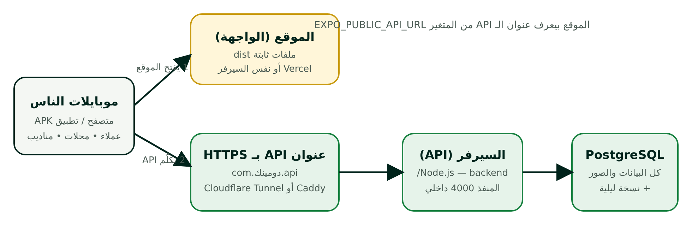
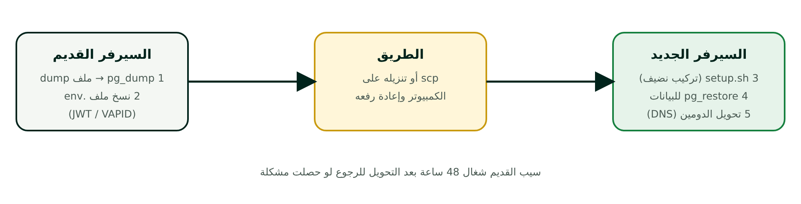
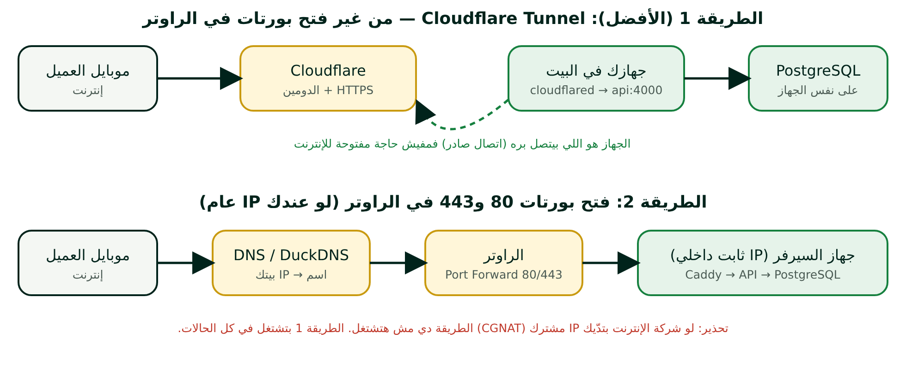

# دليل تشغيل «أطلب أبيس» على أي سيرفر

**نسخة:** 16 نوفمبر 2026 • **للمالك:** خطوات كاملة لنقل التطبيق وتشغيله على سيرفر مؤجر (زي Hostinger) أو على سيرفر في البيت.

> **كلمة أمانة:** كل الأوامر والسكربتات اللي في الدليل (ملفات `deploy/`) شغّالة عندك فعلاً على سيرفر Hostinger. الجزء الخاص بالسيرفر المنزلي (Cloudflare Tunnel والراوتر) **ما اتجرّبش على جهازك**: ملف الإعداد اتفحص شكلياً بس، والباقي مبني على أدوات معروفة. جرّبه الأول على جهاز تجريبي قبل ما تعتمد عليه. والرسومات في الدليل رسومات توضيحية عملتها أنا، مش لقطات شاشة حقيقية من لوحات Hostinger أو الراوتر لأنها بتختلف من مزوّد لمزوّد.

## المحتويات
1. ما الذي في الحزمة
2. الصورة الكاملة (إزاي التطبيق شغّال)
3. قبل ما تبدأ: اللي لازم تحتفظ بيه
4. الطريقة (أ): سيرفر مؤجر (Hostinger / Hetzner / أي Ubuntu)
5. نقل بياناتك من السيرفر الحالي
6. الواجهة (الموقع) وتطبيق الأندرويد
7. الطريقة (ب): سيرفر في البيت
8. التشغيل اليومي: أوامر مهمة
9. النسخ الاحتياطي والاستعادة
10. حل المشاكل
11. قائمة التحقق قبل التحويل
12. مرجع متغيرات البيئة

---

## 1) ما الذي في الحزمة

الملف المضغوط `otlob-abis-source.zip` فيه كل كود التطبيق من آخر نسخة (`main`):

| المسار | ما هو |
|---|---|
| `App.tsx` و`screens/` و`components/` و`lib/` | واجهة التطبيق (Expo / React Native Web) |
| `backend/` | السيرفر (Node.js + Express) وقاعدة البيانات `backend/sql/schema.sql` والاختبارات `backend/tests/` |
| `deploy/` | سكربتات تركيب السيرفر: `setup.sh` و`update.sh` و`backup.sh` و`set-domain.sh` و`migrate-from-neon.sh` وملفات `docker-compose` و`Caddyfile` |
| `.github/workflows/` | بناء ملف الأندرويد APK/AAB على GitHub |
| `signing/release.keystore.enc` | مفتاح توقيع التطبيق (مشفّر، وكلمة فكّه في GitHub باسم `KEYSTORE_PASSPHRASE`) |
| `google-services.json` | إعداد Firebase للأندرويد (بيانات عميل عامة، مش سرّية) |
| `README_*_AR.md` و`DEPLOYMENT_AR.md` | شروحات قديمة (Vercel/Render/Neon ومحلي) |

**اللي مش في الحزمة (ولازم تاخده من السيرفر الحالي):** قاعدة البيانات (المستخدمين والطلبات والصور)، وملف الأسرار `/opt/otlob/.env`، وملف Firebase للإشعارات لو موجود. شرحهم في الأقسام 3 و5.

**المصدر الأصلي:** المستودع على GitHub `mediahefnawi-oss/otlob-abis` هو النسخة الأساسية. سكربت التركيب بيسحب الكود منه مباشرة، فالمستودع لازم يفضل متاح (Public) أو تضيف للسيرفر مفتاح وصول.

---

## 2) الصورة الكاملة



- **الواجهة:** ملفات ثابتة بتتبني بالأمر `npm run build:web`. حالياً على Vercel.
- **السيرفر (API):** برنامج Node.js. بيبني جداول قاعدة البيانات لوحده عند التشغيل، وبينشئ حساب المالك من `OWNER_PHONE` و`OWNER_PASSWORD`.
- **قاعدة البيانات:** PostgreSQL 16 فيها كل حاجة (حتى الصور).
- **HTTPS:** إجباري. على سيرفر مؤجر بيتولاه Caddy تلقائياً. في البيت ممكن Cloudflare Tunnel.

**نصيحة ذهبية:** لو فضّلت على **نفس عنوان الـ API** (مثلاً `api.otlobabis.com`) وغيّرت بس الـ DNS ليشاور على السيرفر الجديد، **مش هتحتاج تعيد بناء الموقع ولا الـ APK**. أي عنوان جديد معناه تغيير `EXPO_PUBLIC_API_URL` وإعادة بناء الاتنين.

---

## 3) قبل ما تبدأ: اللي لازم تحتفظ بيه

احتفظ بنسخة من الحاجات دي في مكان آمن (مش في شات ولا في مستودع عام):

1. **ملف الأسرار** من السيرفر الحالي: `/opt/otlob/.env`. فيه `JWT_SECRET` (لو اتغيّر كل المستخدمين بيتسجّل خروجهم) ومفاتيح `VAPID_*` (لو اتغيّرت اشتراكات الإشعارات على الويب بتتجدد من جديد) وكلمة سر المالك.
2. **آخر نسخة احتياطية للقاعدة:** من `/var/backups/otlob/` (قسم 9).
3. **ملف Firebase** (لو بتستخدم إشعارات الأندرويد): ملف الـ JSON اللي نزّلته من Firebase ← Service accounts.
4. **كلمة `KEYSTORE_PASSPHRASE`** من GitHub ← Settings ← Secrets. من غيرها مفيش تحديثات للتطبيق بنفس التوقيع.
5. **الدومين:** بيانات الدخول لمكان الـ DNS (Namecheap أو غيره).
6. **حساب Hostinger** وتاريخ تجديد الـ VPS (قبل 2026-12-06).

---

## 4) الطريقة (أ): سيرفر مؤجر (Hostinger وأي Ubuntu)

### المواصفات المطلوبة
- نظام **Ubuntu 24.04**.
- **2 معالج و4 جيجا رام** و40 جيجا قرص على الأقل (أقل من كده ممكن لكن بيبطّأ).
- عنوان IPv4 عام وبورتات **80 و443 و22** مفتوحة.

### الخطوة 1: إنشاء السيرفر
1. في Hostinger: **VPS** ← **Manage** ← اختار نظام **Ubuntu 24.04** (نظام نضيف من غير تطبيقات جاهزة). وفي Hetzner: **Add Server** ← Ubuntu 24.04.
2. اكتب كلمة سر الـ root (قوية) واحفظها.
3. بعد ما يشتغل انسخ **عنوان الـ IP** بتاعه.
4. افتح الـ **Browser terminal** (طرفية المتصفح) من لوحة السيرفر. أو من كمبيوترك: `ssh root@عنوان-الIP`.

### الخطوة 2: تركيب البرامج
الصق الأوامر دي في الطرفية (تاخد دقيقتين):

```bash
apt update && apt install -y docker.io docker-compose-v2 git curl jq openssl ufw fail2ban unattended-upgrades
systemctl enable --now docker fail2ban
```

### الخطوة 3: ملف الإعدادات
غيّر **رقم موبايلك** و**كلمة سر المالك** و**الدومين** في الأمر ده قبل ما تلصقه. كلمة السر: 10 حروف أو أكتر، وحروف وأرقام وبس من الرموز دي `_ . @ ! % ^ * + = -` (من غير مسافات أو علامات تنصيص).

```bash
cat > /root/otlob-settings.env <<'EOF'
OWNER_USERNAME=owner
OWNER_PHONE=01000000000
OWNER_PASSWORD=ضع-كلمة-سر-طويلة-إنجليزي
CORS_ORIGINS=https://otlobabis.com
DOMAIN=
VAPID_SUBJECT=mailto:you@example.com
REPO_URL=https://github.com/mediahefnawi-oss/otlob-abis.git
BRANCH=main
EOF
chmod 600 /root/otlob-settings.env
```
- `CORS_ORIGINS` هو **عنوان الموقع** اللي بيفتح منه الناس التطبيق (لو أكتر من واحد افصل بينهم بفاصلة).
- سيب `DOMAIN=` فاضي لو لسه مش جاهز: السكربت هيديك عنوان مؤقت مجاني من نوع `65-108-1-2.sslip.io`.

### الخطوة 4: التركيب
```bash
git clone --depth 1 https://github.com/mediahefnawi-oss/otlob-abis.git /opt/otlob
bash /opt/otlob/deploy/setup.sh
```
أول مرة بياخد 5 إلى 10 دقايق. في الآخر بيطبع ملخص زي ده:

<pre class="term">[otlob-setup] public IP: 65.108.1.2   API address: https://65-108-1-2.sslip.io
[otlob-setup] building and starting (first time takes a few minutes)...
[otlob-setup] waiting for the API to be healthy...
Otlob Abis server
API address (use this as EXPO_PUBLIC_API_URL):  https://65-108-1-2.sslip.io
Health check:                                   https://65-108-1-2.sslip.io/api/health
HTTPS working now:                              YES
Owner login:                                    phone 01000000000
Secrets file (do not share):                    /opt/otlob/.env
Backups folder:                                 /var/backups/otlob</pre>
<p class="note">ده شكل المخرجات المتوقع (رسم توضيحي)، والأرقام عندك هتختلف.</p>

السكربت بيعمل لوحده: الجدار الناري (SSH و80 و443 بس)، وقاعدة بيانات مقفولة عن الإنترنت، ومفاتيح إشعارات الويب، ونسخة احتياطية كل ليلة الساعة 3:17، وإعادة تشغيل تلقائي.

### الخطوة 5: اختبار
افتح في المتصفح: `https://عنوانك/api/health`. لازم تشوف:

<pre class="term">{"ok":true,"service":"otlob-abis-api","database":"connected","standbyConfigured":false,"schema":"ok"}</pre>

### الخطوة 6: الدومين الحقيقي
1. من لوحة الدومين (Namecheap أو غيره) اعمل سجل **A**: الاسم `api` والقيمة **IP السيرفر الجديد**.
2. استنى 5 إلى 30 دقيقة، وبعدين على السيرفر:
```bash
/opt/otlob/deploy/set-domain.sh api.otlobabis.com
```
3. افتح `https://api.otlobabis.com/api/health` (الشهادة بتتجهّز في دقيقة أو اتنين).

### الخطوة 7: إشعارات الأندرويد (اختياري)
ارفع ملف Firebase على السيرفر باسم `/root/firebase.json` (من الكمبيوتر: `scp firebase.json root@IP:/root/firebase.json`) وبعدها:
```bash
bash /opt/otlob/deploy/setup.sh
```

---

## 5) نقل بياناتك من السيرفر الحالي



**الأحسن:** نفّذ الخطوات بعد ما تنهي الخطوات 1 لـ 5 من القسم 4 على السيرفر الجديد، وبترتيب ليلي هادي (قبل ما الناس تصحى).

### الخطوة 1: على السيرفر **القديم**: خد نسخة نهائية
```bash
cd /opt/otlob
docker compose --env-file .env -f deploy/docker-compose.vps.yml stop api      # بيوقف التطبيق لحظياً علشان ما تضيعش طلبات
docker compose --env-file .env -f deploy/docker-compose.vps.yml exec -T db pg_dump -U otlob -Fc otlob > /root/otlob-final.dump
ls -lh /root/otlob-final.dump                                                  # لازم يكون حجمه أكبر من صفر
cat /opt/otlob/.env                                                            # انسخ منه JWT_SECRET و VAPID_PUBLIC_KEY و VAPID_PRIVATE_KEY
```

### الخطوة 2: انقل الملف للسيرفر الجديد
من الطرفية على **السيرفر الجديد**:
```bash
scp root@IP-السيرفر-القديم:/root/otlob-final.dump /root/
```
(بيطلب كلمة سر السيرفر القديم.) ولو مش راضي: نزّله على كمبيوترك بـ `scp` وارفعه بنفس الطريقة، أو استخدم WinSCP/FileZilla.

### الخطوة 3: على السيرفر **الجديد**: استعد البيانات
```bash
cd /opt/otlob
C="docker compose --env-file .env -f deploy/docker-compose.vps.yml"
$C stop api caddy
$C exec -T db pg_restore -U otlob -d otlob --clean --if-exists --no-owner < /root/otlob-final.dump
```
ممكن تظهر بعض الرسائل `does not exist, skipping` وده عادي.

### الخطوة 4: ارجع الأسرار القديمة
افتح `/opt/otlob/.env` وغيّر 3 سطور بس بقيمهم من السيرفر القديم: `JWT_SECRET` و`VAPID_PUBLIC_KEY` و`VAPID_PRIVATE_KEY`:
```bash
nano /opt/otlob/.env
```
**لا تغيّر** `DB_PASSWORD` (القاعدة الجديدة اتعملت بكلمة سرها، ولو غيّرتها السيرفر مش هيتصل). وبعدها:
```bash
$C up -d --force-recreate api caddy
```

### الخطوة 5: تأكد
- `https://عنوانك/api/health` ← `"ok":true` و`"schema":"ok"`.
- اتأكد إن عدد المستخدمين مظبوط:
```bash
$C exec -T db psql -U otlob -d otlob -c "SELECT (SELECT COUNT(*) FROM users) AS users, (SELECT COUNT(*) FROM providers) AS providers, (SELECT COUNT(*) FROM orders) AS orders;"
```
قارن الأرقام بالسيرفر القديم (نفس الأمر هناك).

### الخطوة 6: حوّل الدومين
غيّر سجل **A** (`api`) ليشاور على IP السيرفر الجديد. **الأحسن:** قلّل الـ TTL إلى 300 ثانية قبلها بيوم. وسيب السيرفر القديم **مطفي مش ممسوح** 48 ساعة للرجوع.

### الرجوع لو حصلت مشكلة
شغّل السيرفر القديم تاني (`docker compose ... start api`) وغيّر الـ DNS ليرجع للـ IP القديم. (البيانات اللي اتكتبت على الجديد بعد التحويل مش هتنتقل تلقائياً.)

---

## 6) الواجهة (الموقع) وتطبيق الأندرويد

### الموقع
**الأسهل والموصى بيه: يفضل على Vercel** (مجاني وسريع). لو غيّرت عنوان الـ API: Vercel ← مشروع `otlob-abis-app` ← Settings ← Environment Variables ← `EXPO_PUBLIC_API_URL` = العنوان الجديد (من نوع Config) ← **Redeploy**. واضبط `CORS_ORIGINS` في السيرفر على عنوان الموقع بالظبط.

**بديل: الموقع من نفس السيرفر (ما اتجرّبش عندك):** على جهاز فيه Node 20:
```bash
cd otlob-abis
npm ci
EXPO_PUBLIC_API_URL=https://api.otlobabis.com npm run build:web     # بيطلع مجلد dist
```
ارفع محتوى `dist` على السيرفر (مثلاً `/opt/otlob/site`) وضيف في `deploy/Caddyfile` كتلة تانية لدومين الموقع:
```
otlobabis.com {
	root * /srv/site
	try_files {path} /index.html
	file_server
	encode gzip
}
```
واربط المجلد في `docker-compose.vps.yml` تحت `caddy` ← `volumes` بسطر `- /opt/otlob/site:/srv/site:ro`، وبعدها `docker compose ... up -d --force-recreate caddy`. (ولازم DNS الدومين الرئيسي يشاور على السيرفر.)

### تطبيق الأندرويد (APK)
البناء على GitHub مجاناً (من غير كمبيوتر):
1. GitHub ← المستودع ← Settings ← Secrets and variables ← Actions ← **Variables**: `EXPO_PUBLIC_API_URL` = عنوان الـ API. (اختياري `EXPO_PUBLIC_API_URL_BACKUP` لسيرفر احتياطي.)
2. **Secrets**: `KEYSTORE_PASSPHRASE` (كلمة فك مفتاح التوقيع).
3. Actions ← **build-apk** ← Run workflow (15 إلى 25 دقيقة).
4. الرابط الثابت للتحميل: `https://github.com/mediahefnawi-oss/otlob-abis/releases/latest/download/otlob-abis.apk`.

لازم تعيد بناء الـ APK **فقط لو غيّرت عنوان الـ API**. أما إشعارات الأندرويد فتشتغل من `FIREBASE_SERVICE_ACCOUNT` على السيرفر (الخطوة 7 في القسم 4).

---

## 7) الطريقة (ب): سيرفر في البيت



### الجهاز المناسب
- كمبيوتر صغير (Mini PC) أو لابتوب قديم: **4 جيجا رام على الأقل** (2 جيجا ممكن مع تقليل إعدادات القاعدة) و**SSD** و**كابل شبكة** (مش Wi-Fi).
- **UPS** صغير يحميه من انقطاع الكهرباء (مهم جداً لقاعدة البيانات).
- في الـ BIOS فعّل **Restore on AC Power Loss = Power On** علشان يشتغل لوحده لما الكهرباء ترجع.

### الخطوة 1: نظام التشغيل
1. نزّل **Ubuntu Server 24.04 LTS** من ubuntu.com، واكتبه على فلاشة بـ Rufus أو balenaEtcher.
2. ثبّته وفعّل **OpenSSH server** وقت التثبيت.
3. اختار له **IP ثابت داخلي**: الأسهل من الراوتر (DHCP reservation / Address Reservation) بربط عنوان الـ MAC بعنوان مثل `192.168.1.50`.
4. لو لابتوب: اقفل النوم عند غلق الغطا:
```bash
sudo sed -i 's/^#\?HandleLidSwitch=.*/HandleLidSwitch=ignore/' /etc/systemd/logind.conf && sudo systemctl restart systemd-logind
```

### الخطوة 2: تركيب التطبيق
نفس الأوامر من القسم 4 (الخطوات 2 و3 و4). لو الرام 2 جيجا بس قلّل إعدادات القاعدة قبل التشغيل:
```bash
sed -i 's/shared_buffers=512MB/shared_buffers=256MB/; s/effective_cache_size=1536MB/effective_cache_size=768MB/' /opt/otlob/deploy/docker-compose.vps.yml
```
(ولو عملت ده بعد `git pull` لاحق، التعديل ممكن يتمسح. كرّره.)

### الخطوة 3 (الموصى بيها): Cloudflare Tunnel
**المميزات:** مفيش بورتات مفتوحة في الراوتر، وبتشتغل حتى لو شركة الإنترنت بتدّيك IP مشترك، وHTTPS مجاني. **المتطلب:** دومينك لازم يكون **DNS بتاعه عند Cloudflare** (مجاني: تضيف الدومين وتغيّر الـ nameservers عند المسجّل، والتسجيل نفسه يفضل عند Namecheap).

1. ادخل **dash.cloudflare.com** ← **Zero Trust** ← **Networks** ← **Tunnels** ← **Create a tunnel** ← **Cloudflared**، وسمّيه `otlob`.
2. انسخ **الـ Token** (نص طويل بعد `--token`).
3. في **Public Hostname**: Subdomain `api` والدومين بتاعك، والخدمة: النوع **HTTP** والعنوان `api:4000`.
4. على الجهاز، ضيف التوكن في ملف الأسرار:
```bash
echo 'TUNNEL_TOKEN=الصق-التوكن-هنا' >> /opt/otlob/.env
```
5. شغّل التطبيق بملف المنزل (من غير Caddy):
```bash
cd /opt/otlob
docker compose --env-file .env -f deploy/docker-compose.vps.yml -f deploy/docker-compose.home.yml up -d --build db api cloudflared
```
6. افتح `https://api.دومينك/api/health` من موبايلك بـ **بيانات الموبايل** (مش Wi-Fi البيت) علشان تتأكد إنه شغّال من بره.

بعد كده للتحديث استخدم نفس الأمر (فيه `-f` للملفين). **ما تستخدمش** `update.sh` في الطريقة دي لأنه بيشغّل Caddy.

### الخطوة 3 (بديل): فتح البورتات
1. اتأكد إنك مش وراء CGNAT: قارن عنوان الـ WAN في صفحة الراوتر بعنوانك العام من موقع مثل `whatismyip.com`. لو مختلفين يبقى CGNAT، استخدم Cloudflare Tunnel.
2. من الراوتر: **Port Forwarding**: بورت 80 و443 ← `192.168.1.50` (نفس البورت).
3. اسم ثابت: لو IP بيتك بيتغيّر استخدم DuckDNS أو Cloudflare DDNS وخلّي سجل A يتحدّث تلقائياً.
4. شغّل الإعداد العادي (`setup.sh` بـ `DOMAIN=api.دومينك`) واستخدم Caddy كما في القسم 4.

### الخطوة 4: النسخ الاحتياطي خارج الجهاز (مهم جداً)
النسخة الليلية بتتحفظ على نفس الجهاز، فلو الـ SSD باظ ضاع كل حاجة. انسخها لمكان تاني:
- **أسهل:** فلاشة أو هارد خارجي متوصل بالجهاز: `rsync -a /var/backups/otlob/ /mnt/usb/otlob/` من cron يومي.
- **سحابة:** ثبّت `rclone` (`curl https://rclone.org/install.sh | sudo bash`) وربطه بـ Google Drive بالأمر `rclone config`، وبعدين يومياً: `rclone copy /var/backups/otlob gdrive:otlob-backups`.

### الخطوة 5: المراقبة
أنشئ حساب مجاني في **UptimeRobot** وضيف مراقب HTTP على `https://api.دومينك/api/health` كل 5 دقايق وفعّل التنبيه على الإيميل. هيبلّغك لو السيرفر وقع.

### حدود لازم تعرفها
- نقطة فشل واحدة: الكهرباء أو الإنترنت أو الجهاز. السيرفر المؤجر أثبت للاستخدام الفعلي.
- سرعة الرفع في بيتك هي اللي هتحدد سرعة التطبيق (الصور والتحميل).
- لو بتشغّل الجهاز 24 ساعة، تأكد من التهوية والغبار.

---

## 8) التشغيل اليومي: أوامر مهمة

كل الأوامر على السيرفر من `/opt/otlob`. عرّف اختصار مرة واحدة (سيرفر مؤجر):
```bash
cd /opt/otlob
C="docker compose --env-file .env -f deploy/docker-compose.vps.yml"
```

| المطلوب | الأمر |
|---|---|
| تحديث الكود (سيرفر مؤجر) | `/opt/otlob/deploy/update.sh` |
| حالة الخدمات | `$C ps` |
| آخر 100 سطر من سجل الأخطاء | `$C logs --tail 100 api` |
| متابعة السجل لحظياً | `$C logs -f api` |
| إعادة تشغيل التطبيق | `$C restart api` |
| فحص الصحة | `curl -s http://localhost:4000/api/health` (من داخل الحاوية: `$C exec -T api wget -qO- http://127.0.0.1:4000/api/health`) |
| نسخة احتياطية الآن | `/opt/otlob/deploy/backup.sh` |
| مساحة القرص | `df -h /` |
| بيانات التشغيل | `cat /root/READY.txt` |
| تغيير الدومين | `/opt/otlob/deploy/set-domain.sh api.دومينك` |
| الدخول لقاعدة البيانات | `$C exec db psql -U otlob -d otlob` |

**بعد التحديث:** لو ظهرت رسالة `System restart required` اعمل `reboot` في وقت هادي بعد ما تتأكد إن كل حاجة شغالة. الخدمات بترجع لوحدها.

---

## 9) النسخ الاحتياطي والاستعادة

**تلقائي:** كل ليلة 3:17 فجراً في `/var/backups/otlob/otlob-التاريخ.dump`، وبيحتفظ بآخر 14 يوم.

**نسخة يدوية:** `/opt/otlob/deploy/backup.sh` (بيتحقق إن الملف مش فاضي).

**إزاي تنزّل نسخة على كمبيوترك:**
```bash
scp root@IP-السيرفر:/var/backups/otlob/otlob-20261116-0317.dump .
```

**الاستعادة على نفس السيرفر أو سيرفر جديد:**
```bash
cd /opt/otlob
C="docker compose --env-file .env -f deploy/docker-compose.vps.yml"
$C stop api
$C exec -T db pg_restore -U otlob -d otlob --clean --if-exists --no-owner < /var/backups/otlob/otlob-20261116-0317.dump
$C up -d api
```
جرّب الاستعادة مرة على سيرفر تجريبي، النسخة اللي ما اتجرّبتش استعادتها مش مضمونة.

---

## 10) حل المشاكل

| المشكلة | السبب المحتمل | الحل |
|---|---|---|
| `/api/health` مش بيفتح | HTTPS لسه بيتجهّز، أو الجدار الناري | استنى دقيقتين. افحص `ufw status`، وبورتات 80/443 في لوحة المزوّد |
| `"schema":"ok"` مش ظاهر | القاعدة لسه بتتحدّث | استنى 30 ثانية وجرّب. افحص `$C logs --tail 100 api` |
| المستخدمين اتسجّل خروجهم بعد النقل | `JWT_SECRET` اتغيّر | حط القيمة القديمة في `.env` وأعد تشغيل `api` |
| الإشعارات بطّلت | `VAPID_*` اتغيّرت، أو `FIREBASE_SERVICE_ACCOUNT` ناقص | ارجع المفاتيح القديمة. المستخدم يفتح التطبيق مرة تانية. للأندرويد راجع القسم 4 الخطوة 7 |
| الموقع بيعمل خطأ CORS | `CORS_ORIGINS` غلط | لازم يطابق عنوان الموقع بالظبط (من غير `/` في الآخر) |
| التطبيق بيقول «تعذر الاتصال» | عنوان الـ API غلط في الموقع/الـ APK | راجع `EXPO_PUBLIC_API_URL` وأعد النشر أو البناء |
| `API did not become healthy` أثناء التركيب | كلمة سر المالك أو رقمه بصيغة غلط، أو نقص ذاكرة | `cat /var/log/otlob-setup.log` و`$C logs api` |
| الشهادة (HTTPS) مش بتتولّد | الدومين مش بيشاور على IP السيرفر | `dig +short api.دومينك` لازم يرجع IP السيرفر. لو Cloudflare شغّال بالبروكسي مع Caddy وقّف البروكسي (السحابة رمادية) |
| القرص ممتلئ | سجلات Docker أو نسخ كتير | `docker system prune -f` (آمن للصور غير المستخدمة) ونظّف `/var/backups/otlob` من القديم |
| بعد انقطاع الكهرباء (بيت) السيرفر مش شغّال | الـ BIOS | فعّل Power On after AC loss. وتأكد إن `systemctl is-enabled docker` = enabled |
| `pg_restore` طلّع أخطاء | اختلاف إصدار PostgreSQL | استخدم نفس الإصدار 16 (الحاوية بتاعتنا `postgres:16`) |

**لو علقت:** ابعتلي (أو لأي مبرمج) ناتج الأمرين `$C ps` و`$C logs --tail 100 api` ورسالة الخطأ.

---

## 11) قائمة التحقق قبل التحويل

- [ ] نسخة احتياطية حديثة من القاعدة **منزّلة على كمبيوترك**.
- [ ] نسخة من `/opt/otlob/.env` وملف Firebase و`KEYSTORE_PASSPHRASE` في مكان آمن.
- [ ] السيرفر الجديد شغّال و`/api/health` عليه سليم، وجرّبت دخول المالك عليه بالفعل.
- [ ] خفّضت الـ TTL للدومين إلى 300 ثانية قبلها بيوم.
- [ ] وقت التحويل هادي (قبل الفجر).
- [ ] بعد التحويل جرّبت: تسجيل دخول عميل ومحل ومندوب، وطلب تجريبي، وإشعار تجريبي من الأدمن.
- [ ] مراقب UptimeRobot شغّال.
- [ ] السيرفر القديم متسيّب مطفي 48 ساعة قبل ما تمسحه أو توقف اشتراكه.

---

## 12) مرجع متغيرات البيئة (ملف `/opt/otlob/.env`)

| المتغير | المعنى |
|---|---|
| `DB_PASSWORD` | كلمة سر قاعدة البيانات (بتتولّد تلقائياً. لا تغيّرها بعد التركيب) |
| `JWT_SECRET` | سرّ تسجيل الدخول (32 حرف أو أكتر). تغييره يسجّل الجميع خروج |
| `OWNER_USERNAME` / `OWNER_PHONE` / `OWNER_PASSWORD` | حساب المالك (بيتعمل أول مرة بس. تغيير كلمة السر بعدها من التطبيق) |
| `CORS_ORIGINS` | عنوان الموقع المسموح له يكلّم الـ API |
| `API_HOST` | دومين الـ API (يتظبط من `setup.sh` و`set-domain.sh`) |
| `VAPID_PUBLIC_KEY` / `VAPID_PRIVATE_KEY` / `VAPID_SUBJECT` | مفاتيح إشعارات الويب |
| `FIREBASE_SERVICE_ACCOUNT` | ملف خدمة Firebase كنص (إشعارات الأندرويد) |
| `TUNNEL_TOKEN` | توكن Cloudflare Tunnel (السيرفر المنزلي فقط) |
| `TOKEN_TTL` | مدة صلاحية الدخول (الافتراضي 30 يوم) |
| `DB_POOL_MAX` | عدد اتصالات القاعدة (الافتراضي 20 في ملف الـ compose) |
| `DATABASE_URL_BACKUP` | قاعدة احتياطية للقراءة (اختياري، راجع `README_STANDBY_AR.md`) |
| `OSRM_URL` | خدمة حساب المسافات للتوصيلة (اختياري) |

على الواجهة (وقت البناء فقط): `EXPO_PUBLIC_API_URL` (عنوان الـ API) و`EXPO_PUBLIC_API_URL_BACKUP` (اختياري).

---

### ملاحظات أمان أخيرة
- ملف `.env` ممنوع يترفع على GitHub أو يتبعت في شات.
- لا تفتح بورت 5432 (القاعدة) على الإنترنت أبداً. الإعداد الحالي أصلاً مش بيفتحه.
- غيّر كلمة سر المالك من التطبيق بعد أول دخول.
- فعّل تحديثات الأمان التلقائية (السكربت بيعملها) وراجع الجهاز كل فترة.
